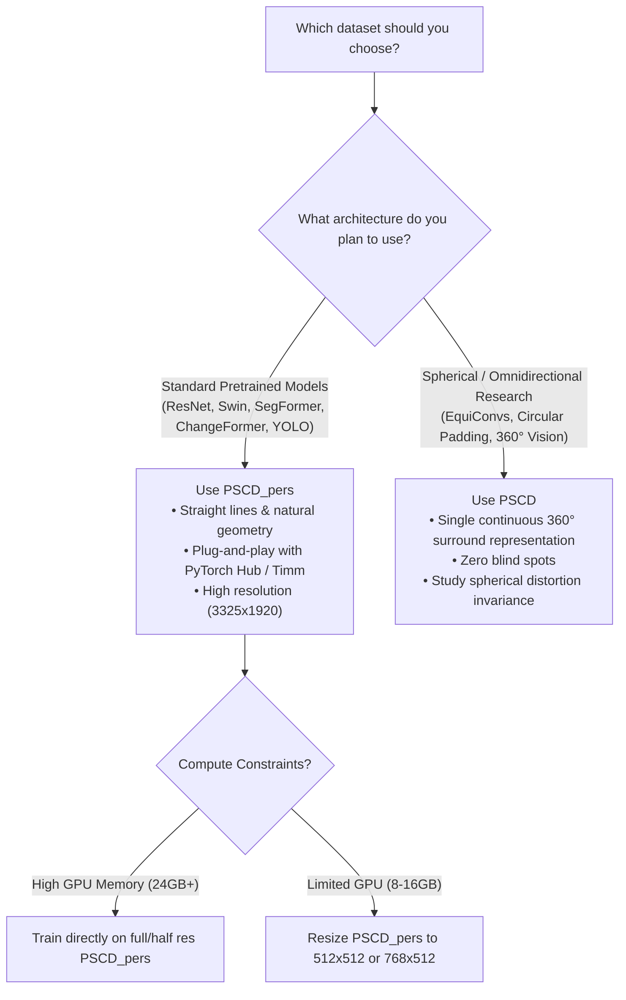
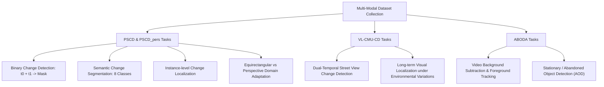

# Comprehensive Dataset Analysis & Technical Documentation (`data.md`)

## 1. Executive Summary

This workspace contains an extensive, multi-modal computer vision benchmark collection specifically assembled for **Scene Change Detection (CD)**, **Semantic Change Localization & Segmentation**, **Panoramic vs. Perspective Vision**, and **Surveillance Video Abandoned Object Detection (AOD)**.

The entire dataset occupies **~33.0 GB** across **76,425 files** organized into **4 core sub-datasets**:

| Sub-Dataset | Modality & Type | Purpose / Task | Pairs / Units | Resolution | Total Size | File Count |
| :--- | :--- | :--- | :--- | :--- | :--- | :--- |
| **`PSCD`** | High-Res Panoramic 360° Images | Equirectangular Scene Change Detection & Semantic Segmentation | 770 time-pairs ($t_0, t_1$) | $4096 \times 1152$ | 9.59 GB | 11,554 files |
| **`PSCD_pers`** | High-Res Perspective Pinhole Views | Rectilinear 4-directional Perspective Change Detection | 3,080 time-pairs ($770 \times 4$ views) | $3325 \times 1920$ | 19.70 GB | 52,377 files |
| **`VL-CMU-CD-binary255`** | Street-View Dual-Timestamp Pairs | Benchmark Urban Vehicle Localization Change Detection | 4,161 time-pairs (Train: 3,732, Test: 429) | $512 \times 512$ | 3.45 GB | 12,483 files |
| **`ABODA`** | Surveillance Video Sequences | Abandoned Luggage / Object Detection in Public Areas | 11 Video Sequences (37,842 frames) | $720 \times 480$ / $640 \times 480$ @ 30 FPS | 257.8 MB | 11 files |
| **TOTAL** | — | — | **7,241 Image Pairs + 11 Video Feeds** | — | **~33.00 GB** | **76,425 files** |

---

## 2. Directory Tree & Folder Architecture

The top-level structure and nested hierarchy of `Dataset/`:

```
Dataset/
├── ABODA/                                  # Abandoned Objects Dataset (11 AVI videos)
│   ├── video1.avi ... video11.avi
│
├── PSCD/                                   # Panoramic Scene Change Detection (Equirectangular)
│   ├── labels_PSCD_reduced_11to8.json      # 8-class reduced ontology specification
│   ├── labels_vista2PSCD_66to11.json       # Mapillary Vistas to PSCD 11-class mapping
│   ├── terms_of_use.txt                    # Citation & academic licensing (AIST)
│   ├── t0/                                 # Baseline/Reference panoramic images (770 files, 4096x1152)
│   ├── t1/                                 # Query/Current panoramic images (770 files, 4096x1152)
│   ├── mask/                               # Binary change masks between t0 and t1 (770 files, {0, 255})
│   ├── mask_t0/                            # Change mask aligned strictly to t0 geometry
│   ├── mask_t1/                            # Change mask aligned strictly to t1 geometry
│   ├── label_t0/                           # Semantic segmentation masks at t0 (8 classes)
│   ├── label_t1/                           # Semantic segmentation masks at t1 (8 classes)
│   ├── label_t0_integ/                     # Integrated semantic masks at t0 (7 classes)
│   ├── label_t1_integ/                     # Integrated semantic masks at t1 (7 classes)
│   ├── label_instance_t0/                  # 16-bit Instance segmentation masks at t0
│   ├── label_instance_t1/                  # 16-bit Instance segmentation masks at t1
│   ├── attribute_t0/                       # Physical object attributes at t0 (2D vs 3D)
│   ├── attribute_t1/                       # Physical object attributes at t1 (2D vs 3D)
│   ├── privacy_mask_t0/                    # Privacy blurs/masks (faces, plates) at t0
│   └── privacy_mask_t1/                    # Privacy blurs/masks (faces, plates) at t1
│
├── PSCD_pers/                              # Perspective-Projected PSCD (Front, Back, Left, Right)
│   ├── cmask/                              # 4 sensor calibration masks (B, F, L, R)
│   ├── t0/                                 # 3,080 perspective images at t0 (3325x1920)
│   ├── t1/                                 # 3,080 perspective images at t1 (3325x1920)
│   ├── mask/, mask_t0/, mask_t1/           # Perspective change ground truths
│   ├── label_t0/, label_t1/                # Perspective semantic segmentation
│   ├── label_t0_integ/, label_t1_integ/    # Perspective integrated semantics
│   ├── label_instance_t0/, instance_t1/    # Perspective instance segmentation
│   ├── attribute_t0/, attribute_t1/        # Perspective physical attributes
│   └── privacy_mask_t0/, privacy_mask_t1/  # Perspective privacy protection masks
│
└── VL-CMU-CD-binary255/                    # CMU Street-View Change Detection (Binarized)
    ├── train/                              # 3,732 training pairs
    │   ├── t0/                             # Reference street-view RGB images (512x512)
    │   ├── t1/                             # Query street-view RGB images (512x512)
    │   └── mask/                           # Grayscale change masks (512x512, values: 0 to 255)
    └── test/                               # 429 testing pairs
        ├── t0/                             # Reference test images (512x512)
        ├── t1/                             # Query test images (512x512)
        └── mask/                           # Test change masks (512x512)
```

---

## 3. Deep Dive: Sub-Dataset 1 — `PSCD` (Panoramic Scene Change Detection)

### 3.1 Overview & Origins
- **Source Paper**: *"Weakly Supervised Silhouette-based Semantic Scene Change Detection"* (Sakurada, Shibuya, Wang — National Institute of Advanced Industrial Science and Technology (AIST), IEEE/CVF 2020).
- **Core Concept**: Captures dynamic real-world outdoor urban environments using a $360^\circ$ panoramic camera mounted on a survey vehicle. The vehicle traversed the same streets at two different points in time ($t_0$ and $t_1$), under varying lighting conditions, seasonal transitions, moving traffic, parked cars, construction, and architectural changes.

### 3.2 Image Characteristics
- **Dimensions**: $4096 \times 1152$ pixels (Equirectangular $360^\circ$ aspect ratio).
- **Channels**: 3-channel RGB (8-bit per channel, unsigned integer `uint8`).
- **File Format**: Standard Lossless PNG (`00000000.png` to `00000769.png`).
- **Volume**: 770 synchronized pairs ($1,540$ panoramic images in total).

### 3.3 Folder Breakdown & Masks
Every scene ID (from `00000000` to `00000769`) contains exactly one file across all 15 directories:

| Directory | Content Description | Image Mode | Data Type | Value Range / Classes |
| :--- | :--- | :--- | :--- | :--- |
| `t0/` | Reference/Past panoramic RGB image | RGB | `uint8` | $[0, 255]$ |
| `t1/` | Query/Current panoramic RGB image | RGB | `uint8` | $[0, 255]$ |
| `mask/` | Binary Change Mask | Grayscale (`L`) | `uint8` | `0` = Unchanged, `255` = Changed |
| `mask_t0/` | Change mask aligned to the coordinate frame of $t_0$ | Grayscale (`L`) | `uint8` | $\{0, 255\}$ |
| `mask_t1/` | Change mask aligned to the coordinate frame of $t_1$ | Grayscale (`L`) | `uint8` | $\{0, 255\}$ |
| `label_t0/` | Semantic segmentation ground truth at $t_0$ | Paletted (`P`) | `uint8` | Class indices $0$ to $8$ |
| `label_t1/` | Semantic segmentation ground truth at $t_1$ | Paletted (`P`) | `uint8` | Class indices $0$ to $8$ |
| `label_t0_integ/` | Integrated semantic segmentation at $t_0$ | Paletted (`P`) | `uint8` | Merged categories (classes $0$ to $7$) |
| `label_t1_integ/` | Integrated semantic segmentation at $t_1$ | Paletted (`P`) | `uint8` | Merged categories (classes $0$ to $7$) |
| `label_instance_t0/` | Instance IDs for each unique physical object | 16-bit (`I;16`) | `uint16` | $[0, N]$ where each instance has a unique ID |
| `label_instance_t1/` | Instance IDs for each unique physical object | 16-bit (`I;16`) | `uint16` | $[0, N]$ where each instance has a unique ID |
| `attribute_t0/` | Dimensional object attribute at $t_0$ | Paletted (`P`) | `uint8` | `0`: Ignore, `1`: 2D-object, `2`: 3D-texture |
| `attribute_t1/` | Dimensional object attribute at $t_1$ | Paletted (`P`) | `uint8` | `0`: Ignore, `1`: 2D-object, `2`: 3D-texture |
| `privacy_mask_t0/` | Protected personal identifiable information | Grayscale (`L`) | `uint8` | Masks out pedestrians, faces, license plates |
| `privacy_mask_t1/` | Protected personal identifiable information | Grayscale (`L`) | `uint8` | Masks out pedestrians, faces, license plates |

### 3.4 Semantic Class Ontology (PSCD Reduced 8-Class)
Derived from Mapillary Vistas 66-class taxonomy down to 8 consolidated classes (`labels_PSCD_reduced_11to8.json`):

| Class Index | Class Name | Display Name | Assigned Color (RGB) | Sub-categories Included |
| :---: | :--- | :--- | :---: | :--- |
| **0** | `ignore` | Ignore / Background | `[0, 0, 0]` | Vegetation, road, sky, terrain, void, water |
| **1** | `moving-object--vehicle` | Vehicles | `[255, 165, 0]` (Orange) | Cars, trucks, buses, motorcycles, bicycles |
| **2** | `barrier` | Barrier | `[255, 255, 0]` (Yellow) | Curbs, fences, guard-rails, walls |
| **3** | `structure` | Structure | `[0, 191, 255]` (Deep Sky Blue) | Buildings, bridges, tunnels |
| **4** | `lane-marking` | Lane Marking | `[255, 255, 255]` (White) | Crosswalks, general road markings |
| **5** | `object-traffic` | Object (Traffic) | `[255, 0, 255]` (Magenta) | Traffic lights, front/back traffic signs |
| **6** | `object-others` | Object (Others) | `[138, 43, 226]` (Blue Violet) | Street lights, poles, trash cans, hydrants |
| **7** | `human` | Human | `[255, 0, 0]` (Red) | Pedestrians, riders, groups of humans |

### 3.5 Quantitative Change Density
- In panoramic scenes, changes represent sparse, localized alterations against large static backgrounds.
- Sampled mean change percentage across panoramic masks: **$7.90\%$ of total image pixels**.

---

## 4. Deep Dive: Sub-Dataset 2 — `PSCD_pers` (Perspective PSCD)

### 4.1 Overview & Projection Methodology
- Standard Convolutional Neural Networks (CNNs) and Vision Transformers (ViTs) assume rectilinear pinhole camera projections. Applying standard convolutions directly on $360^\circ$ equirectangular panoramas introduces significant geometric distortion near the poles and seam edges.
- `PSCD_pers` solves this by unwarping each $360^\circ$ panoramic equirectangular image into **4 rectilinear perspective projections**:
  - **`_F`**: Front view
  - **`_B`**: Back view
  - **`_L`**: Left view
  - **`_R`**: Right view

### 4.2 Image Characteristics
- **Dimensions**: $3325 \times 1920$ pixels (Ultra-high resolution rectilinear view).
- **Naming Pattern**: `<SceneID>_<Direction>.png` (e.g., `00000000_F.png`, `00000000_B.png`, `00000000_L.png`, `00000000_R.png`).
- **File Counts**: $770 \text{ scenes} \times 4 \text{ directions} = 3,080$ images per folder.
- **Storage**: 19.70 GB (Largest single sub-dataset).

### 4.3 Calibration Masks (`cmask/`)
The `cmask` directory contains 4 binary sensor boundary masks:
- `mask_sensor_F.png`
- `mask_sensor_B.png`
- `mask_sensor_L.png`
- `mask_sensor_R.png`
These masks delineate the valid sensor field-of-view (FOV) and unwarping bounds, allowing models to mask out edge vignetting and invalid projective borders during loss calculation.

---

## 5. Comprehensive Comparison: `PSCD` vs. `PSCD_pers`

While `PSCD` and `PSCD_pers` share identical underlying real-world urban scenes recorded by the same survey platform, they represent two radically different geometric paradigms. Understanding their differences is crucial for choosing the right neural architecture, loss functions, and data augmentation pipelines.

### 5.1 Direct Side-by-Side Comparison Matrix

| Feature / Dimension | `PSCD` (Panoramic) | `PSCD_pers` (Perspective) | Deep Learning Impact |
| :--- | :--- | :--- | :--- |
| **Projection Model** | Equirectangular / Cylindrical $360^\circ$ spherical projection | Rectilinear / Pinhole planar perspective projection | `PSCD` distorts straight lines into curves; `PSCD_pers` preserves straight lines. |
| **Resolution ($W \times H$)** | $4096 \times 1152$ pixels | $3325 \times 1920$ pixels | Different aspect ratios: $\sim 3.56:1$ (ultra-wide) vs $\sim 1.73:1$ (~16:9 standard). |
| **Aspect Ratio** | $3.56 : 1$ (Panoramic strip) | $1.73 : 1$ (Standard wide camera) | Standard CNNs handle 1.73:1 much better than ultra-wide 3.56:1. |
| **Images per Scene** | **1 image** per timestamp (Full $360^\circ$ surround view) | **4 images** per timestamp (`_F`, `_B`, `_L`, `_R`) | `PSCD_pers` breaks the scene into directional quadrants. |
| **Pixels per Scene** | $4,096 \times 1,152 = \mathbf{4.72 \text{ Megapixels}}$ | $4 \times (3325 \times 1920) = \mathbf{25.54 \text{ Megapixels}}$ | **`PSCD_pers` has $5.4\times$ higher pixel sampling density**, capturing far finer details. |
| **Field of View (FOV)** | $360^\circ$ Horizontal $\times$ $\sim 100^\circ$ Vertical | $\sim 90^\circ\text{–}105^\circ$ Horizontal per view | `PSCD` has zero blind spots; `PSCD_pers` splits the environment into 4 distinct views. |
| **Total Files in Dataset** | **11,554 files** | **52,377 files** | `PSCD_pers` contains $4\times$ more data files (plus calibration masks & metadata). |
| **Disk Footprint** | **9.59 GB** | **19.70 GB** | `PSCD_pers` requires double the storage space. |
| **Filename Schema** | `<Scene_ID>.png`<br>*(e.g., `00000000.png`)* | `<Scene_ID>_<Dir>.png`<br>*(e.g., `00000000_F.png`)* | Easy programmatic pairing using string splitting (`_F`, `_B`, `_L`, `_R`). |
| **Sensor / Boundary Mask** | **None** (Continuous spherical surface) | **`cmask/`** (4 directional sensor masks) | In `PSCD_pers`, unwarping creates non-active edge borders masked by `cmask`. |
| **Object Seam Handling** | Objects at $0^\circ / 360^\circ$ seam are split into left & right edges | Objects are self-contained within each camera view frustum | No seam wrap-around issues in `PSCD_pers`. |
| **Pretrained Model Fit** | Requires spherical / circular convolutions or specialized ViT | **100% plug-and-play** with ImageNet-pretrained CNNs and Vision Transformers | ResNet, Swin, SegFormer, ChangeFormer, ConvNeXt work directly on `PSCD_pers`. |

---

### 5.2 Deep Dive into Key Differences

#### A. Geometric Projection & Distortion
- **`PSCD` (Equirectangular)**:
  - Maps latitude and longitude $(\phi, \theta)$ of the sphere directly onto cartesian $(x, y)$ coordinates.
  - Straight roads, utility poles, and buildings appear curved towards the image periphery.
  - Standard planar convolution kernels ($3 \times 3$, $5 \times 5$) assume spatial translation invariance, which is violated on equirectangular grids because a $3 \times 3$ kernel covers different solid angles depending on latitude.
- **`PSCD_pers` (Perspective Rectification)**:
  - Re-projects rays from the optical center onto planar virtual camera image planes facing **Front (`_F`)**, **Back (`_B`)**, **Left (`_L`)**, and **Right (`_R`)**.
  - Straight physical lines remain straight lines in the image.
  - Objects maintain their natural perspective shapes, allowing standard object detectors and semantic segmentation networks to recognize cars, pedestrians, and structures without custom distortion-handling layers.

#### B. Pixel Density & Detail Level
- In `PSCD`, the entire $360^\circ$ scene is compressed into $4096 \times 1152$ pixels. Small distant objects (such as traffic signs, hydrants, or distant pedestrians) occupy only a few pixels.
- In `PSCD_pers`, each directional view is rendered at $3325 \times 1920$ pixels. Across all four views, a single scene contains **25.5 million pixels** compared to **4.7 million pixels** in `PSCD`—a **$5.4\times$ increase in sampling resolution**. This yields dramatically sharper contours, clear license plates, readable text on signs, and crisp change boundaries.

#### C. Active Sensor Regions & `cmask/`
- When spherical panoramic images are transformed into rectilinear perspective views, the rectangular bounding box can include pixels that fall outside the true lens optical field of view.
- `PSCD_pers` provides dedicated sensor calibration masks in `PSCD_pers/cmask/`:
  - `mask_sensor_F.png`
  - `mask_sensor_B.png`
  - `mask_sensor_L.png`
  - `mask_sensor_R.png`
- These binary masks denote pixels where image data is valid ($255$) vs. unmapped / invalid border areas ($0$). Neural network loss functions can mask out invalid pixels using element-wise multiplication:
  $$\mathcal{L}_{\text{masked}} = \frac{\sum (\mathcal{L}_{\text{pixel}} \odot M_{\text{sensor}})}{\sum M_{\text{sensor}}}$$

#### D. Boundary Seam & Wraparound Dynamics
- In `PSCD`, the left ($x=0$) and right ($x=4096$) edges are geographically continuous ($-\pi \equiv +\pi$). An object located behind the vehicle will be split into two halves: one half at the far left and the other half at the far right.
- In `PSCD_pers`, each of the four views acts as a traditional independent photo. While an object may occasionally appear in the overlap zone between adjacent cameras (e.g., between `_F` and `_R`), it is never artificially split across opposite sides of the same image frame.

---

### 5.3 When to Use Which Dataset?



---

## 6. Deep Dive: Sub-Dataset 3 — `VL-CMU-CD-binary255` (Vehicle Localization Change Detection)

### 6.1 Overview
- Originates from the **CMU (Carnegie Mellon University) Street View Change Detection** dataset, widely used as an international benchmark for robotic visual localization, long-term mapping, and autonomous driving.
- Focuses on detecting changes in real-world urban street scenes captured over multiple months/seasons.
- In this version, ground truth change masks are pre-processed to standard binarized grayscale values ($0$ to $255$).

### 6.2 Image Characteristics & Structure
- **Dimensions**: $512 \times 512$ pixels (Square patch-based pairs).
- **Format**: PNG, 8-bit RGB for images, 8-bit Grayscale for masks.
- **Split Breakdown**:
  - **`train/`**: 3,732 triplets (`t0`, `t1`, `mask`) $\to$ 11,196 files.
  - **`test/`**: 429 triplets (`t0`, `t1`, `mask`) $\to$ 1,287 files.
  - **Total**: 4,161 scene triplets (12,483 files, 3.45 GB).

### 6.3 Filename Anatomy
Filenames follow a deterministic structure:
$$\text{Example: } \mathbf{001\_1\_00\_180.png}$$
- **`001`**: Sequence / Route ID.
- **`1`**: Pass / Trajectory run number.
- **`00`**: Frame / Location index along the route.
- **`180`**: Camera heading angle ($0^\circ, 90^\circ, 180^\circ, 270^\circ$).

### 6.4 Quantitative Change Density
- Urban street changes in this dataset encompass moved parked cars, road construction signs, store signage modifications, and seasonal foliage changes.
- Sampled mean change percentage across train masks: **$5.19\%$ of total image pixels**.

---

## 7. Deep Dive: Sub-Dataset 4 — `ABODA` (Abandoned Objects Dataset)

### 7.1 Overview
- **Domain**: Video Surveillance & Public Safety.
- **Problem**: Automated detection of unattended or abandoned objects (such as backpacks, suitcases, boxes, and packages) in busy public areas like transit stations, airport terminals, hallways, and outdoor sidewalks.
- **Format**: 11 Uncompressed / Motion-JPEG AVI Video files (`video1.avi` to `video11.avi`).

### 7.2 Video Specifications & Metadata

| File Name | Resolution | Frame Rate | Total Frames | Duration | File Size | Scene Context |
| :--- | :---: | :---: | :---: | :---: | :---: | :--- |
| `video1.avi` | $640 \times 480$ | 30.0 FPS | 2,189 | 73.0 sec | 4.2 MB | Indoor corridor / hallway |
| `video2.avi` | $720 \times 480$ | 30.0 FPS | 2,818 | 94.0 sec | 5.5 MB | Outdoor walkway / public entrance |
| `video3.avi` | $720 \times 480$ | 30.0 FPS | 2,608 | 87.0 sec | 4.2 MB | Hallway / waiting lobby |
| `video4.avi` | $720 \times 480$ | 30.0 FPS | 1,169 | 39.0 sec | 1.8 MB | Short transit scene |
| `video5.avi` | $720 \times 480$ | 30.0 FPS | 3,297 | 110.0 sec | 29.9 MB | Complex lighting with moving pedestrians |
| `video6.avi` | $720 \times 480$ | 30.0 FPS | 6,744 | 225.0 sec | 48.2 MB | High activity station entrance |
| `video7.avi` | $720 \times 480$ | 30.0 FPS | 4,801 | 160.2 sec | 43.7 MB | Outdoor plaza with shadow dynamics |
| `video8.avi` | $720 \times 480$ | 30.0 FPS | 4,781 | 159.5 sec | 43.7 MB | High-traffic pedestrian thoroughfare |
| `video9.avi` | $720 \times 480$ | 30.0 FPS | 2,485 | 82.9 sec | 22.3 MB | Indoor transit concourse |
| `video10.avi` | $720 \times 480$ | 30.0 FPS | 2,260 | 75.4 sec | 20.3 MB | Static camera surveillance corridor |
| `video11.avi` | $640 \times 480$ | 30.0 FPS | 4,501 | 150.0 sec | 33.9 MB | Long-term surveillance with occlusions |
| **TOTAL** | — | **30.0 FPS** | **37,842 frames** | **~21.0 mins** | **257.8 MB** | Multi-environment surveillance |

---

## 8. Machine Learning & Computer Vision Tasks Supported

This dataset collection supports a wide spectrum of deep learning research tasks:



1. **Binary Scene Change Detection (SCD)**:
   - Input: Image pair $(I_{t0}, I_{t1})$.
   - Output: Binary mask $M \in \{0, 1\}^{H \times W}$ pinpointing physical structural changes while remaining invariant to illumination, season, and camera angle differences.
2. **Semantic Scene Change Detection (SSCD)**:
   - Output: Semantic category of the changed entity (e.g., whether a newly appeared object is a Vehicle, Barrier, Structure, or Human).
3. **Instance Change Segmentation**:
   - Differentiating individual object instances in change masks using `label_instance_t0` and `label_instance_t1`.
4. **Omnidirectional vs. Perspective Representation Learning**:
   - Investigating performance trade-offs between processing raw equirectangular panoramas ($4096 \times 1152$) vs. rectilinear directional perspective tiles ($3325 \times 1920$).
5. **Abandoned Object Video Analytics**:
   - Tracking temporal persistence: identifying when a stationary item is detached from an owner and left unattended past a temporal threshold.

---

## 9. Data Engineering & Preprocessing Guidelines

### 9.1 macOS Resource Fork Cleanup
In `Dataset/PSCD_pers/privacy_mask_t0`, `privacy_mask_t1`, and `label_t0`, there are AppleDouble files (`._*`) created when transferring files across macOS and Windows/Linux filesystems.
- **Rule**: When writing Python data loaders (`glob` or `os.listdir`), always exclude files starting with `._`:
  ```python
  image_files = [f for f in os.listdir(folder) if not f.startswith('._') and f.endswith('.png')]
  ```

### 9.2 Loading 16-Bit Instance Masks
- The files in `label_instance_t0/` and `label_instance_t1/` are stored in 16-bit grayscale (`uint16`, mode `I;16`).
- Standard OpenCV `cv2.imread(path)` without flags will truncate them to 8-bit.
- **Correct approach**:
  ```python
  import cv2
  from PIL import Image

  # Method A: OpenCV with unchanged flag
  instance_mask = cv2.imread(mask_path, cv2.IMREAD_UNCHANGED)  # Returns uint16 array

  # Method B: Pillow
  instance_mask = np.array(Image.open(mask_path))             # Returns uint16 array
  ```

### 9.3 Utilizing Calibration Masks (`cmask`)
- When training on `PSCD_pers`, multiply the loss function by the valid camera region in `cmask` to prevent gradients from penalizing invalid outer boundary pixels.

---

## 10. Quick-Start PyTorch DataLoader Example

Here is a ready-to-use PyTorch dataset snippet for loading paired images and change masks:

```python
import os
import torch
from torch.utils.data import Dataset
from PIL import Image
import torchvision.transforms.functional as TF

class ChangeDetectionDataset(Dataset):
    """
    Generic PyTorch Dataset for Paired Change Detection.
    Works seamlessly with PSCD, PSCD_pers, or VL-CMU-CD.
    """
    def __init__(self, root_dir, split="train", target_size=(512, 512)):
        self.root_dir = root_dir
        self.target_size = target_size
        
        # Subdirectories for t0, t1, and ground-truth mask
        self.t0_dir = os.path.join(root_dir, "t0")
        self.t1_dir = os.path.join(root_dir, "t1")
        self.mask_dir = os.path.join(root_dir, "mask")
        
        self.filenames = sorted([
            f for f in os.listdir(self.t0_dir)
            if not f.startswith("._") and f.lower().endswith((".png", ".jpg"))
        ])

    def __len__(self):
        return len(self.filenames)

    def __getitem__(self, idx):
        fname = self.filenames[idx]
        
        # Load t0, t1, and mask
        img_t0 = Image.open(os.path.join(self.t0_dir, fname)).convert("RGB")
        img_t1 = Image.open(os.path.join(self.t1_dir, fname)).convert("RGB")
        mask = Image.open(os.path.join(self.mask_dir, fname)).convert("L")
        
        # Resize to target dimension
        img_t0 = TF.resize(img_t0, self.target_size)
        img_t1 = TF.resize(img_t1, self.target_size)
        mask = TF.resize(mask, self.target_size, interpolation=TF.InterpolationMode.NEAREST)
        
        # Convert to Tensors
        tensor_t0 = TF.to_tensor(img_t0)                     # Shape: [3, H, W], range [0, 1]
        tensor_t1 = TF.to_tensor(img_t1)                     # Shape: [3, H, W], range [0, 1]
        tensor_mask = (TF.to_tensor(mask) > 0.5).float()     # Shape: [1, H, W], binary {0, 1}
        
        return {
            "t0": tensor_t0,
            "t1": tensor_t1,
            "mask": tensor_mask,
            "filename": fname
        }

# Example instantiation:
# ds = ChangeDetectionDataset("Dataset/VL-CMU-CD-binary255/train", target_size=(512, 512))
# print(f"Loaded {len(ds)} training pairs.")
```

---

## 11. Summary & Academic References

1. **PSCD / PSCD_pers**:
   - Sakurada, Ken, Mikiya Shibuya, and Weimin Wang. *"Weakly Supervised Silhouette-based Semantic Scene Change Detection."* IEEE/CVF Conference on Computer Vision and Pattern Recognition (CVPR) Workshops / IROS, 2020.
   - License: Non-commercial academic research use (AIST).
2. **VL-CMU-CD**:
   - Alcantarilla, Pablo F., et al. *"Street-View Change Detection with Deconvolutional Networks."* Autonomous Robots, Robotics and Science Systems (RSS), Carnegie Mellon University.
3. **ABODA**:
   - Benchmark Dataset for Automated Abandoned Object Detection in Video Surveillance.

